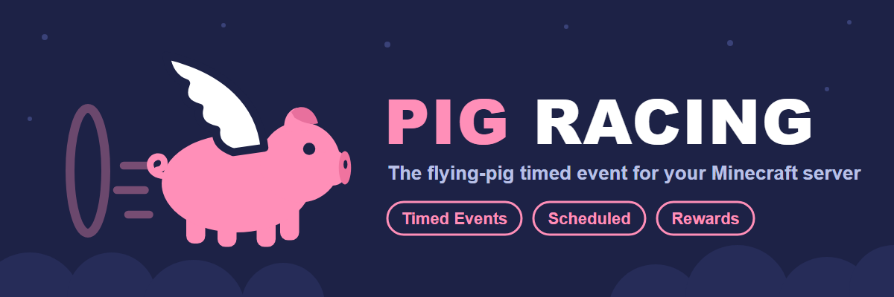

<p align="center">
  
</p>

<p align="center">
  Flying pig races through checkpoint rings, as a timed event on your server. Open one by hand or on a schedule, and reward whoever finishes.
</p>

<p align="center">
  
  
  
</p>

<p align="center">
  <a href="docs/README.md"><b>Documentation</b></a> ·
  <a href="https://github.com/aidan-b07/PigRacing/releases/latest"><b>Download</b></a> ·
  <a href="https://github.com/aidan-b07/PigRacing/issues"><b>Report a bug</b></a>
</p>

---

## Features

- **Flappy-bird flight.** Racers ride a saddled pig that flies where they look. Tap space to flap upwards; gravity does the rest, so height comes from timing your taps.
- **Checkpoint rings.** The track is a loop of animated particle rings. Each racer's next ring is highlighted, and every ring passed makes the pig faster.
- **Crashes cost you.** Touch the ground and you're sent back to your last ring with your speed reset. Punch another racer's pig to knock them off course.
- **A proper event.** `/race start` announces the race in chat with a click-to-join message and a countdown. Racers wait in a lobby, then fly a countdown into GO.
- **Scheduled races.** Open races every so many minutes, or at set times of day. Players can check when the next one is with `/race next`.
- **Time limits and results.** Finishers get a place and a time on the results board. When the time limit runs out, anyone still flying doesn't finish.
- **Rewards.** Run any console commands for 1st, 2nd, 3rd and so on, and for everyone who finishes.
- **Built in game.** Place the lobby, the start and every ring by standing where you want them. Preview the track, list rings and click to teleport to one.
- **One jar for every version.** Runs on Spigot and Paper from 1.8.8 to the latest release.
- **Everything is configurable.** Flight physics, ring visuals, sounds, every message, title and action bar, and which commands racers can use.

## How a race works

1. An admin runs `/race start`, or a scheduled race opens. Everyone online gets a clickable join message.
2. Players join with a click or `/race join` and wait in the lobby until joining closes.
3. Everyone is put on a pig at the start, and the countdown runs to **GO!**
4. Racers fly through the rings in order. Flying back through the first ring completes a lap.
5. After the last lap, each racer's place and time is announced. Rewards are given once they're back in the lobby.

See [How a race works](docs/how-a-race-works.md) for the details.

## Installation

1. Download the jar from [releases](https://github.com/aidan-b07/PigRacing/releases/latest) and put it in your server's `plugins` folder.
2. Start the server once. Pig Racing creates its files in `plugins/PigRacing/`.
3. Build your track in game (below), then run `/race start`.

**Requirements:** Spigot or Paper, Minecraft 1.8.8 or newer, Java 8 or newer (whatever your server version needs). Nothing else is needed: everything Pig Racing uses is inside the jar.

## Building a track

Stand in each spot and run:

```
/race setlobby          where racers wait before the start
/race setstart          the start line, facing where you look
/race ring add 3        a ring here, facing where you look (repeat for each ring, in order)
/race preview           see the rings without a race on
```

Stand at the bottom middle of an opening and look through it, and the ring fits it exactly. The first ring is the start and finish line, so place it just in front of the start.

See [Building a track](docs/building-a-track.md) for ring sizes, editing rings and the optional boundary.

## Commands

| Command | What it does | Permission |
|---|---|---|
| `/race join` | Join the race that's taking sign-ups | Everyone |
| `/race leave` | Leave the race | Everyone |
| `/race next` | When the next race opens | Everyone |
| `/race help` | List the commands you can use | Everyone |
| `/race start` | Open a race for sign-ups | `pigracing.start` |
| `/race forcestart` | Close joining and start now, whatever the player count | `pigracing.admin` |
| `/race stop` | Stop the current race | `pigracing.admin` |
| `/race reload` | Read every config file again | `pigracing.admin` |
| `/race setlobby`, `/race setstart` | Set the lobby or start where you stand | `pigracing.admin` |
| `/race ring add [size]` | Add a ring where you stand, facing where you look | `pigracing.admin` |
| `/race ring remove [n]`, `list`, `tp <n>`, `clear` | Edit the track's rings | `pigracing.admin` |
| `/race preview` | Show or hide the rings while no race is on | `pigracing.admin` |
| `/race boundary pos1`, `pos2`, `set`, `clear` | An optional box racers must stay in | `pigracing.admin` |

`/race` also works as `/pr`, `/pigrace` and `/pigracing`.

## Permissions

| Permission | Default | What it does |
|---|---|---|
| `pigracing.start` | Op | Use `/race start` |
| `pigracing.admin` | Op | Every admin command. Includes `pigracing.start` |

Joining, leaving and `/race next` need no permission.

## Configuration

All files are in `plugins/PigRacing/`.

| File | What's in it |
|---|---|
| `config.yml` | Race rules, the schedule, blocked commands, flight physics, ring visuals and sounds |
| `messages.yml` | Every chat message, title and action bar |
| `rewards.yml` | Console commands run for finishers |
| `track.yml` | The lobby, start, rings and boundary. Written by the setup commands |

Colour codes use `&`. Run `/race reload` after changing anything. A setting missing from your files uses its default.

Every option is explained in the docs: [config.yml](docs/configuration/config.md), [messages.yml](docs/configuration/messages.md) and [rewards.yml](docs/configuration/rewards.md).

### Rewards

```yaml
Places:
  1:
    - "give {player} diamond 3"
    - "say {player} won the pig race in {time}!"
  2:
    - "give {player} gold_ingot 5"
  3:
    - "give {player} iron_ingot 5"

AllFinishers:
  - "give {player} cooked_porkchop 8"
```

Commands run from the console. Racers who leave, or haven't finished when time runs out, get nothing.

### Scheduled races

```yaml
Schedule:
  Enabled: true
  EveryMinutes: 30         # every 30 minutes from server start, 0 for none
  Times: ["18:00", "21:00"] # and/or at these times, server time
  MinOnline: 2             # skip the slot if fewer players are online
```

## Building from source

You need JDK 8 or newer and Maven.

```bash
mvn package -Dserver.skip=true
```

The plugin is built to `target/pigracing-<version>.jar`.

Without `-Dserver.skip=true`, the build also sets up a Paper test server in `run/<version>/` and installs the plugin there. Pick the version with `-Dserver.version=1.8.8`.

## Support

Found a bug or have an idea? [Open an issue](https://github.com/aidan-b07/PigRacing/issues).
